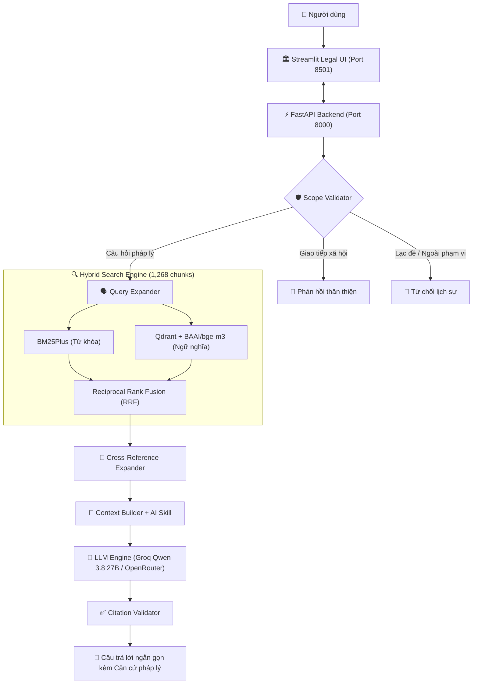

<div align="center">


# ⚖️ VN-Legal RAG Assistant
### Cổng Tra Cứu Pháp Luật Giao Thông Đường Bộ Việt Nam (2025)

[](https://www.python.org/)
[](https://fastapi.tiangolo.com/)
[](https://streamlit.io/)
[](https://qdrant.tech/)
[](#7-kiểm-thử--đánh-giá)

**Trợ lý AI tra cứu quy tắc giao thông, phân hạng & điểm giấy phép lái xe và mức xử phạt vi phạm hành chính dựa trên kiến trúc Hybrid RAG — cam kết trả lời ngắn gọn, đúng trọng tâm và trích dẫn chính xác đến từng Điều, Khoản, Điểm.**

[Tổng quan](#-1-tổng-quan--văn-bản-áp-dụng) •
[Tính năng](#-2-tính-năng-nổi-bật) •
[Kiến trúc](#-3-kiến-trúc-hệ-thống) •
[Cài đặt](#-4-hướng-dẫn-cài-đặt--khởi-chạy) •
[API](#-5-tài-liệu-api) •
[Ví dụ thực tế](#-6-ví-dụ-tra-cứu-thực-tế) •
[Kiểm thử](#-7-kiểm-thử--đánh-giá)

</div>

---

## 📌 1. Tổng quan & Văn bản áp dụng

**VN-Legal RAG Assistant** được xây dựng chuyên biệt cho bài toán hỏi – đáp pháp luật tiếng Việt, khắc phục tình trạng ảo giác (hallucination) của LLM bằng cơ chế truy xuất lai đa tầng kết hợp kiểm duyệt trích dẫn chặt chẽ.

Hệ thống tích hợp đồng bộ **02 văn bản pháp luật chính thức** có hiệu lực từ **01/01/2025**:

| STT | Văn bản pháp luật | Số hiệu | Quy mô cấu trúc | Số đoạn chỉ mục |
| :-: | :--- | :---: | :---: | :---: |
| **1** | **Luật Trật tự, an toàn giao thông đường bộ** | `36/2024/QH15` | 9 Chương • 89 Điều | 500 chunks |
| **2** | **Nghị định xử phạt VPHC & trừ điểm, phục hồi điểm GPLX** | `168/2024/NĐ-CP` | 4 Chương • 55 Điều | 768 chunks |
| | **Tổng cộng** | **2 văn bản** | **144 Điều** | **1,268 chunks** |

---

## ✨ 2. Tính năng nổi bật

- 🔍 **Hybrid Search (BM25Plus + BGE-M3 + RRF):** Hợp nhất tìm kiếm từ khóa chính xác tiếng Việt có dấu với tìm kiếm ngữ nghĩa đa ngôn ngữ (`BAAI/bge-m3` trên `Qdrant`) qua thuật toán **Reciprocal Rank Fusion (RRF)**.
- 🗣️ **Hiểu ngôn ngữ đời thường:** Bộ `QueryExpander` tự động ánh xạ tiếng lóng, cách nói tự nhiên (*nhậu, kẹp 3, bắn tốc độ, bao nhiu tiền...*) sang thuật ngữ pháp lý chuẩn xác.
- 🧩 **Structure-Aware Chunking:** Phân đoạn văn bản bảo toàn trọn vẹn cấu trúc phân cấp *Chương → Điều → Khoản → Điểm*, đính kèm siêu dữ liệu số hiệu văn bản và trích xuất tham chiếu chéo tự động.
- 🎯 **AI Skill trả lời ngắn gọn, tiết kiệm token:** Tích hợp skill chuyên biệt ([`concise_legal_answer.md`](src/generation/skills/concise_legal_answer.md)) giúp câu trả lời súc tích (2–4 dòng), đi thẳng vào trọng tâm và luôn đính kèm `[Tên văn bản, Điều X, khoản Y, điểm Z]`.
- 🛡️ **Phân luồng thông minh & Chống ảo giác:**
  - Giao tiếp xã hội thân thiện (*chào hỏi, hỏi thăm*) được phản hồi tự nhiên mà không truy xuất nhầm luật.
  - Câu hỏi lạc đề, ngoài phạm vi hoặc châm biếm được từ chối lịch sự, rõ ràng.
  - `CitationValidator` đối chiếu chéo mọi Điều/Khoản trong câu trả lời với nguồn truy xuất.
- 🏛️ **Giao diện pháp lý trang trọng:** Thiết kế tông màu tư pháp (xanh navy – đỏ đô – vàng đồng), ẩn toàn bộ thông số kỹ thuật phức tạp đối với người dùng cuối.

---

## 🏗️ 3. Kiến trúc hệ thống



### Cấu trúc thư mục dự án

```text
VN-Legal-RAG-Assistant/
├── data/
│   ├── input/                          # Văn bản nguồn sạch (Luật 36 DOCX + NĐ 168 TXT)
│   ├── processed/                      # Chunks JSONL sau xử lý (ignored trên Git)
│   ├── indexes/                        # BM25 index & Qdrant local DB (ignored trên Git)
│   └── evaluation/                     # Bộ benchmark 25 câu hỏi đánh giá
├── scripts/
│   ├── run_ingestion.py                # Parse & Structure-Aware Chunking (1,268 chunks)
│   ├── build_indexes.py                # Xây dựng chỉ mục BM25 + Qdrant Vector
│   └── run_evaluation.py               # Chạy benchmark nghiệm thu tự động
├── src/
│   ├── common/                         # Cấu hình (Pydantic Settings) & Logging
│   ├── ingestion/                      # DocxLawParser, TextLawParser, Chunker, CrossRef
│   ├── retrieval/                      # QueryExpander, BM25, VectorSearch, HybridSearch
│   ├── generation/
│   │   ├── skills/
│   │   │   └── concise_legal_answer.md # AI Skill trả lời ngắn gọn, chuẩn trích dẫn
│   │   ├── scope_validator.py          # Phân luồng giao tiếp / lạc đề / pháp lý
│   │   ├── context_builder.py          # Đóng gói prompt & nạp skill tự động
│   │   ├── llm_client.py               # Client Groq / OpenRouter chuẩn OpenAI
│   │   ├── citation_validator.py       # Kiểm duyệt trích dẫn chống ảo giác
│   │   └── generator.py                # Orchestrator toàn pipeline RAG
│   ├── api/                            # FastAPI REST endpoints & Schemas
│   └── ui/                             # Streamlit Legal Portal + Custom Assets
├── tests/
│   ├── unit/                           # Kiểm thử từng module (API, Chunker, Retrieval, Gen)
│   └── integration/                    # Kiểm thử End-to-End toàn luồng RAG
├── .env.example                        # Mẫu biến môi trường
└── pyproject.toml                      # Khai báo dependencies & cấu hình project
```

---

## 🚀 4. Hướng dẫn Cài đặt & Khởi chạy

### Yêu cầu hệ thống
- **Python** `3.11+`
- **API Key** miễn phí từ [Groq Console](https://console.groq.com/keys) *(khuyên dùng — tốc độ phản hồi ~0.25s)* hoặc [OpenRouter](https://openrouter.ai/keys).

### Bước 1: Clone dự án & cài đặt môi trường
```bash
git clone <URL-repo-của-bạn>
cd VN-Legal-RAG-Assistant

python3 -m venv .venv
source .venv/bin/activate
pip install -e ".[dev]"
```

### Bước 2: Cấu hình biến môi trường
```bash
cp .env.example .env
```
Mở file `.env` và điền API Key của bạn:
```env
LLM_PROVIDER=groq
GROQ_API_KEY=gsk_xxxxxxxxxxxxxxxxxxxxxxxxxxxx
GROQ_MODEL=qwen/qwen3.8-27b
```

### Bước 3: Nạp dữ liệu & xây dựng chỉ mục tìm kiếm
```bash
# 1. Phân tách Luật 36/2024/QH15 + Nghị định 168/2024/NĐ-CP -> 1,268 chunks
python scripts/run_ingestion.py

# 2. Xây dựng chỉ mục BM25 và Qdrant Vector (thêm CUDA_VISIBLE_DEVICES="" nếu chạy trên CPU)
python scripts/build_indexes.py
```

### Bước 4: Khởi chạy ứng dụng

- **Giao diện Web (Streamlit Legal Portal):**
  ```bash
  streamlit run src/ui/app.py
  ```
  Mở trình duyệt tại: `http://localhost:8501`

- **Backend REST API (FastAPI — tùy chọn):**
  ```bash
  uvicorn src.api.app:app --host 0.0.0.0 --port 8000 --reload
  ```
  Tài liệu Swagger UI: `http://localhost:8000/docs`

---

## 🔌 5. Tài liệu API

| Method | Endpoint | Mô tả |
| :---: | :--- | :--- |
| `GET` | `/health` | Kiểm tra trạng thái hoạt động của hệ thống & số chunks đã lập chỉ mục |
| `GET` | `/api/v1/documents` | Thông tin metadata các văn bản pháp luật hiện hành |
| `POST` | `/api/v1/search` | Tìm kiếm trực tiếp điều khoản luật qua Hybrid Search (`BM25 + BGE-M3 + RRF`) |
| `POST` | `/api/v1/chat` | Hỏi đáp pháp lý trọn gói kèm trích dẫn và kiểm duyệt nguồn |

---

## 💬 6. Ví dụ tra cứu thực tế

| Câu hỏi người dùng | Phản hồi từ VN-Legal RAG Assistant |
| :--- | :--- |
| *"Nếu mà nhậu mà lái xe máy thì bị phạt bao nhiu tiền?"* | Mức phạt tiền cho người lái xe máy có nồng độ cồn chia thành 3 khung:<br>• **≤ 50 mg/100ml máu (hoặc ≤ 0,25 mg/l khí thở):** 2.000.000 – 3.000.000 đồng `[Nghị định 168/2024/NĐ-CP, Điều 7, khoản 6, điểm a]`.<br>• **> 50 – 80 mg/100ml máu (hoặc > 0,25 – 0,4 mg/l khí thở):** 6.000.000 – 8.000.000 đồng `[Nghị định 168/2024/NĐ-CP, Điều 7, khoản 8, điểm b]`.<br>• **> 80 mg/100ml máu (hoặc > 0,4 mg/l khí thở):** 8.000.000 – 10.000.000 đồng `[Nghị định 168/2024/NĐ-CP, Điều 7, khoản 9, điểm d]`. |
| *"Vượt đèn đỏ bằng ô tô bị phạt bao nhiêu tiền?"* | Phạt tiền từ **18.000.000 đến 20.000.000 đồng** `[Nghị định 168/2024/NĐ-CP, Điều 6, khoản 9, điểm b]`. |
| *"Nhậu mà được người khác chở về thì có bị sao không?"* | **Không bị xử phạt**, vì bạn không trực tiếp điều khiển phương tiện. Quy định cấm chỉ áp dụng với người **điều khiển phương tiện** có nồng độ cồn `[Luật 36/2024/QH15, Điều 9, khoản 2]`. |

---

## 🧪 7. Kiểm thử & Đánh giá

Chạy toàn bộ **23 bài kiểm thử** (Unit Tests + Integration Tests):
```bash
pytest tests/ -v
```

Chạy bộ Benchmark đánh giá độ chính xác truy xuất & trích dẫn:
```bash
python scripts/run_evaluation.py
```

---

## ⚠️ Miễn trừ trách nhiệm

> Hệ thống được xây dựng nhằm mục đích nghiên cứu, học tập và hỗ trợ tra cứu nhanh văn bản pháp luật giao thông đường bộ Việt Nam. Các câu trả lời chỉ mang tính chất tham khảo và **không thay thế** tư vấn pháp lý chính thức từ luật sư hoặc quyết định của cơ quan nhà nước có thẩm quyền.
